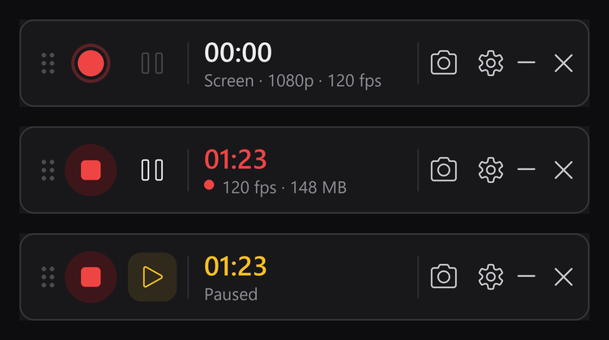
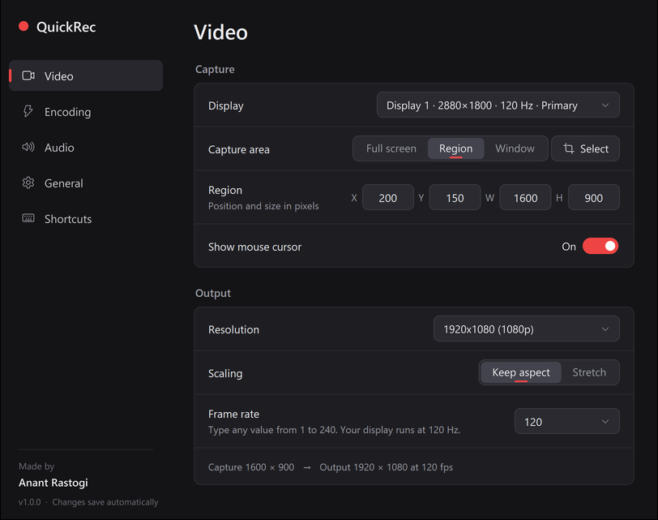
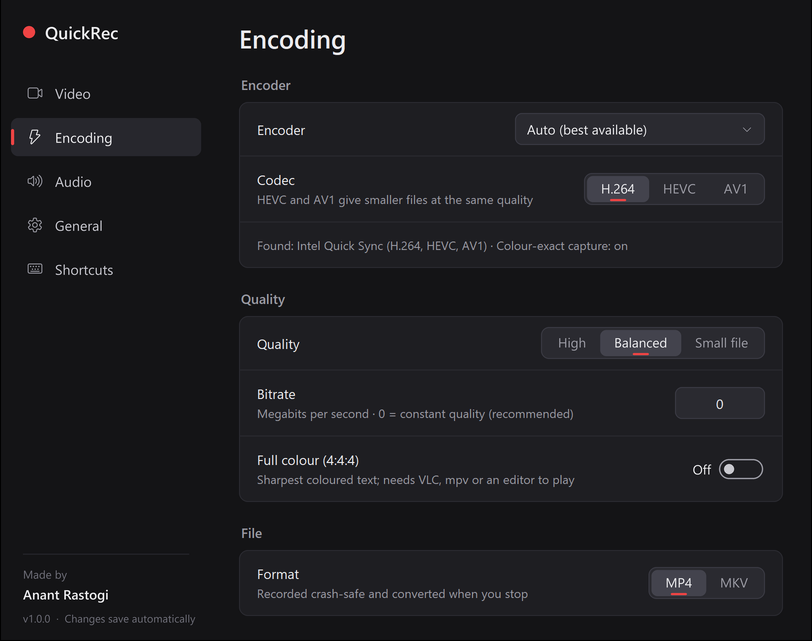
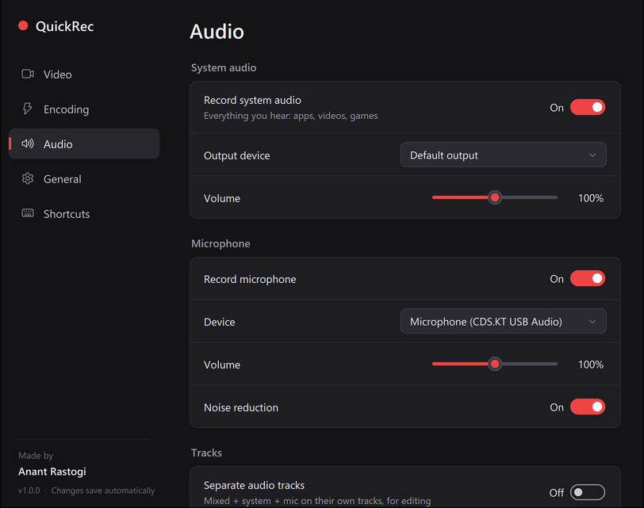
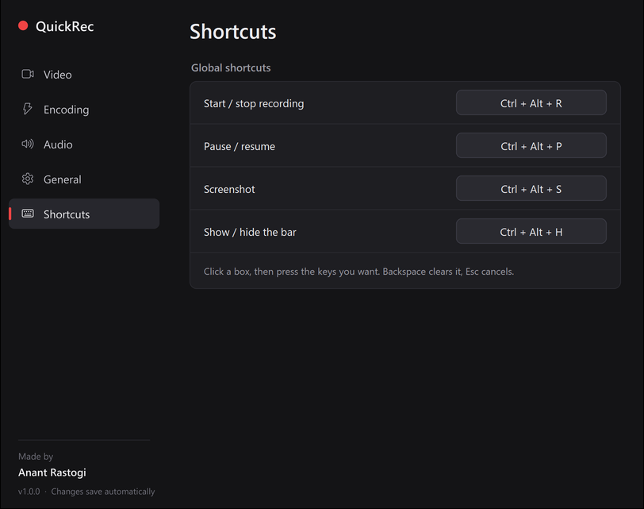

<div align="center">

# QuickRec

**A tiny, fast screen recorder for Windows 11.**
One floating bar, colour-exact capture, up to 120 fps (and beyond), hardware encoding.

Made by **Anant Rastogi**



</div>

---

## Why QuickRec

- **Minimal.** The whole app is one small bar: record, pause, screenshot, settings. Everything else lives in a right-click menu or the settings window.
- **Colour-exact.** QuickRec captures with Windows Graphics Capture and converts colours correctly (BT.709, tagged sRGB). Recordings match your screen within 1–2 values out of 255, even with HDR-style "advanced colour" modes or calibration tools such as X-Rite Color Assistant turned on.
- **High frame rate.** It records at any rate from 1 to 240 fps, and the output is always an exact constant frame rate, so editors and players handle it well.
- **GPU all the way.** The image is captured, scaled and encoded on the graphics card (Intel Quick Sync, NVIDIA NVENC or AMD AMF), so the CPU stays free. If the GPU path isn't available, QuickRec falls back to the CPU automatically.

## Download

1. Open the **[Releases](../../releases)** page and download `QuickRec-vX.Y.Z-win64.zip`.
2. Unzip it anywhere, for example `C:\Apps\QuickRec`.
3. Run **QuickRec.exe**. Keep `ffmpeg.exe` in the same folder.

You don't need to install Python or anything else. The first time you run it, Windows SmartScreen may warn about an unrecognised app; click **More info → Run anyway**. The executable isn't code-signed.

## Using it

| Action | Mouse | Shortcut (global) |
|---|---|---|
| Start / stop recording | ● | `Ctrl + Alt + R` |
| Pause / resume | ❚❚ | `Ctrl + Alt + P` |
| Screenshot (lossless PNG) | 📷 | `Ctrl + Alt + S` |
| Show / hide the bar | | `Ctrl + Alt + H` |
| Quick menu (area, fps, resolution, audio) | Right-click the bar | |
| Move the bar | Drag it | |

Recordings are saved to `Videos\QuickRec`. After saving, click the timer on the bar to open the file. All shortcuts can be changed in **Settings → Shortcuts**.

## Features

**Capture**
- Full screen on any monitor, a region you drag out, or a window you click
- Exact X / Y / W / H region entry
- Optional mouse cursor
- Optional click-through border around the recorded area
- Countdown before recording (off, 3, 5 or 10 s)

**Video**
- Output resolution: native, 4K, 1440p, 1080p, 720p, 480p or any custom size, either keeping the aspect ratio or stretching
- Frame rate from 1 to 240 fps, always constant frame rate
- H.264, HEVC or AV1
- Quality presets (High / Balanced / Small file) or a fixed bitrate
- **Full colour 4:4:4** mode (HEVC Range Extensions) for the sharpest coloured text
- MP4 or MKV. Recordings are written crash-safe as MKV and converted when you stop.

**Audio**
- System audio (anything you hear), with a choice of output device
- Microphone, with optional noise reduction
- A volume control for each, up to 200%
- Optional **separate tracks** (mixed + system + mic) for editing

**Workflow**
- Pause and resume; the parts are joined without re-encoding
- Automatic recovery if capture is interrupted, for example by a UAC prompt or a display change
- Auto-stop timer
- The bar, countdown and border are hidden from your own recordings
- A modern settings window where changes save automatically

## Screenshots

| Video | Encoding |
|---|---|
|  |  |
| **Audio** | **Shortcuts** |
|  |  |

## Tips for the smoothest 120 fps

- Plug the laptop in, or set **Windows Settings → System → Power → Power mode** to *Best performance*. On battery in *Best power efficiency* mode, Windows slows the GPU down and frames can be skipped.
- Native resolution on a high-resolution screen is the heaviest case. Recording at 1080p is lighter.
- The file is always exactly the frame rate you choose. If the screen itself updates more slowly (for example a 60 fps video playing), the extra frames are repeats.

## How it works

QuickRec is a single Python file with a Tk interface. Every control is drawn with Pillow so it stays sharp at any display scaling. It drives FFmpeg for the heavy lifting:

```
Windows Graphics Capture ──► Intel/NVIDIA/AMD GPU scaler + BT.709 conversion ──► hardware encoder ──► MKV
WASAPI loopback + mic (Python) ──► audio-only FFmpeg ──► lossless FLAC ──┘ aligned & muxed when you stop
```

Video and audio run in separate processes. When they shared one FFmpeg process, the screen capture was held back waiting for audio and lost frames. When you stop, the audio is aligned to the video and both are joined into one file.

Settings are stored in `%APPDATA%\QuickRec\config.json`. If something goes wrong, the FFmpeg log is in `%APPDATA%\QuickRec\ffmpeg.log`.

## Building from source

Requirements: Windows 10/11, Python 3.10+, and an FFmpeg build that includes the `gfxcapture` filter (FFmpeg 8 or newer, e.g. `winget install Gyan.FFmpeg`).

```powershell
git clone <your-repo-url>
cd QuickRec
python -m pip install -r requirements.txt
pythonw QuickRec.pyw          # run from source
```

To build the standalone `.exe` and the release ZIP:

```powershell
.\build.ps1 -Version 1.0.0
```

The output goes to `dist\`: `QuickRec.exe`, a copy of `ffmpeg.exe`, and `QuickRec-v1.0.0-win64.zip`.

Run `python QuickRec.pyw --selftest` for a quick headless recording test.

## Author

**Anant Rastogi**: design, development and testing of QuickRec.

## License

QuickRec is © 2026 Anant Rastogi and released under the [MIT License](LICENSE). The release ZIP also contains FFmpeg, which is licensed separately under the GPL; see [THIRD_PARTY_NOTICES.md](THIRD_PARTY_NOTICES.md).
